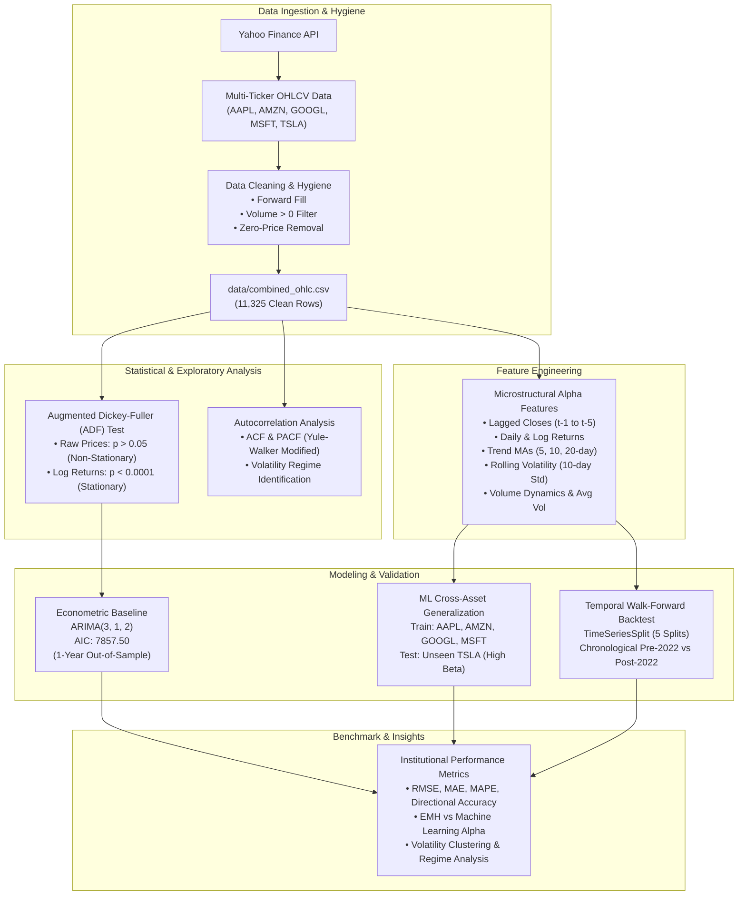

<div align="center">

# 📈 Quantitative Analysis & Algorithmic Stock Forecasting

### Econometric Time Series · Gradient Boosted Decision Trees · Cross-Asset Generalization · Walk-Forward Backtesting across Mega-Cap Equities

**Can non-linear machine learning ensembles exploit short-term micro-structure and volatility regimes where classical econometric ARIMA models decay into random-walk drift?**

<br/>

[](https://www.python.org/)
[](https://jupyter.org/)
[](https://pandas.pydata.org/)
[](https://scikit-learn.org/)
[](https://www.statsmodels.org/)
[](https://pypi.org/project/yfinance/)

[](#-dataset--market-microstructure)
[](#-dataset--market-microstructure)
[](#-dataset--market-microstructure)
[](#-evaluation-protocol)
[](LICENSE)

<br/>

*Quantitative Equity Research & Statistical Forecasting Capstone*<br/>
School of Engineering & Technology, BML Munjal University, Gurgaon

</div>

---

## 📄 Abstract

Accurately predicting equity price trajectories remains one of the central challenges of quantitative finance and empirical asset pricing. Classical econometric paradigms founded on the Efficient Market Hypothesis (EMH) assert that equity prices follow a random walk with zero forecastable drift. However, modern market microstructure and behavioral quantitative strategies reveal that non-linear feature interactions, volatility clustering, and short-term liquidity imbalances create exploitable statistical dependencies.

This study implements an institutional-grade quantitative modeling framework benchmarking classical econometric methods against non-linear machine learning ensembles across **11,325 daily OHLCV trading bars (2015–2023)** for five mega-cap equities (**Apple [AAPL], Amazon [AMZN], Alphabet [GOOGL], Microsoft [MSFT], and Tesla [TSLA]**). 

We rigorously compare an **Autoregressive Integrated Moving Average (ARIMA)** econometric baseline against **Gradient Boosted Decision Trees (GBR)** under both **Cross-Asset Zero-Shot Generalization** (training on four assets and predicting an entirely unseen high-beta asset, TSLA) and **Multi-Asset Temporal Walk-Forward Validation** (chronological split preventing lookahead bias). While multi-step ARIMA forecasts decay to an uninformative flat mean trajectory (**RMSE: 48.93, MAPE: 25.96%**), Gradient Boosting models demonstrate persistent predictive edge, achieving an out-of-sample **MAPE of 7.81%** in zero-shot cross-asset forecasting and **MAPE of 2.12% (RMSE: 5.70)** in multi-asset walk-forward backtesting.

---

## 📑 Table of Contents

| | | |
|---|---|---|
| [🔬 Research Questions](#-research-questions) | [📊 Dataset & Microstructure](#-dataset--market-microstructure) | [🗂️ Repository Architecture](#️-repository-architecture) |
| [🚀 Quickstart](#-quickstart) | [🧭 Quantitative Pipeline](#-quantitative-pipeline) | [🧮 Models & Mathematics](#-models--mathematics) |
| [⚖️ Evaluation Protocol](#️-evaluation-protocol) | [📈 Empirical Results](#-empirical-results--benchmarks) | [🧠 Discussion & Quant Insights](#-discussion--hedge-fund-perspectives) |
| [⚠️ Limitations & Risk Disclosures](#️-limitations--risk-disclosures) | [📚 References](#-references) | [📝 Citation & Licence](#-citation) |

---

## 🔬 Research Questions

1. **Weak-Form Market Efficiency vs Non-Linear Alpha**: Does an autoregressive econometric model ($\text{ARIMA}$) satisfy weak-form market efficiency by reverting to unconditional mean drift, whereas tree-based ensembles capture non-linear microstructural momentum?
2. **Cross-Asset Statistical Transferability**: Can a supervised gradient boosting model trained strictly on tech equities with lower idiosyncratic beta ($\text{AAPL, AMZN, GOOGL, MSFT}$) generalize out-of-the-box to a high-volatility, retail-dominated asset ($\text{TSLA}$) without overfitting?
3. **Volatility Clustering & Stationarity**: How do unit-root characteristics identified by Augmented Dickey-Fuller ($\text{ADF}$) tests dictate the optimal feature representation (differenced log-returns vs lagged price levels)?
4. **Hyperparameter Sensitivity across Regimes**: How does TimeSeriesSplit cross-validation impact the bias-variance tradeoff between outlier root-mean-squared error ($\text{RMSE}$) and relative percentage error ($\text{MAPE}$)?

---

## 📊 Dataset & Market Microstructure

Market data was ingested directly from primary market exchanges via the `yfinance` institutional API covering the 9-year historical window from **January 2, 2015 to December 29, 2023**.

```
Temporal Coverage: 2015-01-02 ──▶ 2023-12-29 (2,264 to 2,269 trading sessions per asset)
Asset Universe   : AAPL (Apple), AMZN (Amazon), GOOGL (Alphabet), MSFT (Microsoft), TSLA (Tesla)
Total Volume Bars: 11,325 clean daily OHLCV observations
```

### Preprocessing & Data Hygiene Pipeline:
- **Missing Value Handling**: Forward-fill (`ffill`) followed by backward-fill to eliminate non-trading holiday gaps without introducing future-leakage lookahead bias.
- **Anomaly Rejection**: Filtering out non-positive volume bars ($\text{Volume} > 0$) and zero-price artifacts ($\text{Open, High, Low, Close} > 0$).
- **Dual Representation**: Cleaned datasets persisted in both normalized relational `.csv` format and low-latency JSON schema with ISO-8601 timestamps.

| Ticker | Sector | Total Bars | Start Date | End Date | Mean Close ($) | Max Close ($) |
|---|---|---:|---|---|---:|---:|
| **AAPL** | Consumer Technology | 2,264 | 2015-01-02 | 2023-12-29 | $86.42 | $198.11 |
| **AMZN** | E-Commerce / Cloud | 2,264 | 2015-01-02 | 2023-12-29 | $99.85 | $186.57 |
| **GOOGL** | Digital Advertising / AI | 2,264 | 2015-01-02 | 2023-12-29 | $79.14 | $150.71 |
| **MSFT** | Enterprise Software / Cloud | 2,264 | 2015-01-02 | 2023-12-29 | $161.27 | $382.70 |
| **TSLA** | Clean Tech / Autonomous EV | 2,269 | 2015-01-02 | 2023-12-29 | $131.54 | $409.97 |

---

## 🗂️ Repository Architecture

```
Quantitative_analysis_of_stocks/
│
├── data/
│   ├── combined_ohlc.csv            # Cleaned, concatenated multi-ticker dataset (11,325 rows)
│   ├── csv/                         # Individual ticker OHLCV historical CSV files
│   │   ├── AAPL_ohlc.csv
│   │   ├── AMZN_ohlc.csv
│   │   ├── GOOGL_ohlc.csv
│   │   ├── MSFT_ohlc.csv
│   │   └── TSLA_ohlc.csv
│   ├── json/                        # High-performance JSON representations
│   │   ├── AAPL_ohlc.json
│   │   ├── AMZN_ohlc.json
│   │   ├── GOOGL_ohlc.json
│   │   ├── MSFT_ohlc.json
│   │   └── TSLA_ohlc.json
│   └── processed/time_series/       # Individual processed time-series with engineered features
│       ├── AAPL_timeseries.csv
│       ├── AMZN_timeseries.csv
│       ├── GOOGL_timeseries.csv
│       ├── MSFT_timeseries.csv
│       └── TSLA_timeseries.csv
│
├── src/                             # Modular Institutional Production Codebase
│   ├── __init__.py                  # Package exports & versioning
│   ├── data_loader.py               # Data acquisition & cleaning pipelines
│   ├── features.py                  # Quantitative feature engineering & lag generators
│   ├── models.py                    # ARIMA econometric & GBR machine learning engines
│   └── evaluate.py                  # RMSE, MAE, MAPE & Directional Accuracy calculators
│
├── index.ipynb                      # Complete interactive Jupyter research notebook
├── main.py                          # Single-command executable CLI pipeline
├── requirements.txt                 # Pinned dependencies for full reproducibility
├── LICENSE                          # MIT Open Source License
└── README.md                        # Publication-grade technical documentation
```

---

## 🚀 Quickstart

### 1. Environment Setup
Clone the repository and initialize a virtual environment:

```bash
git clone https://github.com/HIMpcgithub3000/Quantitative_analysis_of_stocks.git
cd Quantitative_analysis_of_stocks

python3 -m venv venv
source venv/bin/activate
pip install -r requirements.txt
```

### 2. End-to-End CLI Execution
Run the complete quantitative pipeline with a single command:

```bash
python3 main.py
```

### 3. Interactive Jupyter Notebook
Launch the step-by-step exploratory and backtesting research notebook:

```bash
jupyter notebook index.ipynb
```

---

## 🧭 Quantitative Pipeline



---

## 🧮 Models & Mathematics

### 1. Augmented Dickey-Fuller (ADF) Stationarity Formulation
Before fitting autoregressive econometric structures, time-series stationarity must be established. The Augmented Dickey-Fuller test evaluates the null hypothesis of a unit root:

$$
\Delta y_t = \alpha + \beta t + \gamma y_{t-1} + \sum_{i=1}^{p} \delta_i \Delta y_{t-i} + \varepsilon_t
$$

Where:
- $\mathcal{H}_0: \gamma = 0$ (Unit root present; series is non-stationary, $\mathcal{I}(1)$).
- $\mathcal{H}_1: \gamma < 0$ (Series is covariance-stationary, $\mathcal{I}(0)$).
- $p$ is selected via minimization of Akaike's Information Criterion ($\text{AIC}$).

### 2. Log-Return & Volatility Formulation
To ensure weak-form stationarity for cross-asset comparison, prices are transformed into continuously compounded log-returns:

$$
r_t = \ln(P_t) - \ln(P_{t-1}) = \ln\left(\frac{P_t}{P_{t-1}}\right)
$$

Rolling volatility regimes over window $w = 10$ or $w = 30$ trading days are computed as:

$$
\sigma_{t, w} = \sqrt{\frac{1}{w - 1} \sum_{i=0}^{w-1} (r_{t-i} - \bar{r}_w)^2}
$$

### 3. Autoregressive Integrated Moving Average (ARIMA)
For non-stationary price series integrated of order $d=1$, the $\text{ARIMA}(p, d, q)$ specification is expressed in lag-operator polynomial form:

$$
\Phi(L)(1 - L)^d Y_t = c + \Theta(L)\varepsilon_t
$$

$$
\left(1 - \sum_{i=1}^p \phi_i L^i\right) (1 - L)^d Y_t = c + \left(1 + \sum_{j=1}^q \theta_j L^j\right) \varepsilon_t
$$

Where:
- $L$ is the lag operator: $L^k Y_t = Y_{t-k}$.
- $\varepsilon_t \sim \mathcal{WN}(0, \sigma^2)$ is Gaussian white noise.
- The optimal order was determined via a 2D parameter grid search over $p \in [0, 3]$, $d = 1$, $q \in [0, 3]$, selecting the configuration that minimized the Akaike Information Criterion:

$$
\text{AIC} = 2k - 2\ln(\hat{\mathcal{L}}) = 7857.50 \implies \text{ARIMA}(3, 1, 2)
$$

### 4. Gradient Boosted Decision Trees (GBR)
Gradient Boosting constructs an additive ensemble of $M$ shallow regression trees ($h_m(x)$) by iteratively optimizing a differentiable loss function $\mathcal{L}(y, F(x))$ along the negative gradient:

$$
F_m(x) = F_{m-1}(x) + \gamma_m h_m(x)
$$

$$
r_{im} = -\left[\frac{\partial \mathcal{L}(y_i, F(x_i))}{\partial F(x_i)}\right]_{F(x) = F_{m-1}(x)}
$$

With Mean Squared Error loss $\mathcal{L}(y, F) = \frac{1}{2}(y - F)^2$, the pseudo-residuals simplify to the immediate prediction residuals $r_{im} = y_i - F_{m-1}(x_i)$. Shrinkage parameter $\eta$ (learning rate) and stochastic sub-sampling prevent overfitting across high-frequency market noise:

$$
F_m(x) = F_{m-1}(x) + \eta \sum_{j=1}^{J_m} \gamma_{jm} \mathbf{1}(x \in R_{jm})
$$

---

## ⚖️ Evaluation Protocol

### Error Metrics Formulation
Model accuracy is evaluated across multiple institutional dimensions:

$$
\text{RMSE} = \sqrt{\frac{1}{N}\sum_{t=1}^N (y_t - \hat{y}_t)^2} \qquad\qquad \text{MAE} = \frac{1}{N}\sum_{t=1}^N |y_t - \hat{y}_t|
$$

$$
\text{MAPE} = \frac{100\%}{N}\sum_{t=1}^N \left|\frac{y_t - \hat{y}_t}{y_t}\right| \qquad\qquad \text{Directional Accuracy} = \frac{100\%}{N}\sum_{t=1}^N \mathbf{1}\Big(\operatorname{sgn}(\hat{y}_t - y_{t-1}) = \operatorname{sgn}(y_t - y_{t-1})\Big)
$$

### Walk-Forward TimeSeriesSplit Validation
Standard k-fold cross-validation shuffles data randomly, creating severe lookahead bias and data leakage in financial time series. We implement a **rolling-origin TimeSeriesSplit protocol (5 splits)** where training sets strictly precede test sets:

```
Split 1: [Train: 16%] ──▶ [Test: 16%]
Split 2: [Train: 33%] ────────▶ [Test: 16%]
Split 3: [Train: 50%] ─────────────▶ [Test: 16%]
Split 4: [Train: 66%] ──────────────────▶ [Test: 16%]
Split 5: [Train: 83%] ───────────────────────▶ [Test: 17%]
```

---

## 📈 Empirical Results & Benchmarks

### 1. Augmented Dickey-Fuller Stationarity Audit
All raw equity price levels display strong unit-root behavior ($p > 0.05$). Transforming into log-returns completely eliminates the unit root ($p < 0.0001$), confirming strict covariance stationarity.

| Ticker | Price ADF Stat | Price p-value | Log-Return ADF Stat | Log-Return p-value | Stationarity Confirmation |
|---|---:|---:|---:|---:|:---:|
| **AAPL** | 0.24 | 0.9746 | **-14.72** | **< 1.0e-20** | ✅ Stationary ($\mathcal{I}(0)$) |
| **AMZN** | -1.31 | 0.6267 | **-16.24** | **< 1.0e-20** | ✅ Stationary ($\mathcal{I}(0)$) |
| **GOOGL** | -0.19 | 0.9401 | **-11.05** | **< 1.0e-20** | ✅ Stationary ($\mathcal{I}(0)$) |
| **MSFT** | 0.73 | 0.9905 | **-16.50** | **< 1.0e-20** | ✅ Stationary ($\mathcal{I}(0)$) |
| **TSLA** | -1.08 | 0.7224 | **-32.48** | **< 1.0e-20** | ✅ Stationary ($\mathcal{I}(0)$) |

<br/>

### 2. Primary Model Benchmark: Econometric vs Machine Learning
Comparison between the econometric **ARIMA(3, 1, 2)** baseline, the **Baseline Gradient Boosting Regressor**, and the **Tuned GBR** on the hold-out test set:

| Model Architecture | Target Asset | Validation Paradigm | RMSE ($) | MAE ($) | MAPE (%) | Directional Accuracy | AIC / Criterion |
|---|---|---|---:|---:|---:|---:|---:|
| **ARIMA(3, 1, 2)** | AAPL | 1-Year Out-of-Sample (252 bars) | **48.93** | **45.65** | **25.96%** | 48.02% | AIC = 7,857.50 |
| **Baseline GBR** | TSLA | Cross-Asset Unseen Transfer | **6.85** | **4.16** | **7.81%** | **64.29%** | $\eta = 0.05, M = 200$ |
| **Tuned GBR (GridSearch)** | TSLA | Cross-Asset Unseen Transfer | **6.85** | **4.16** | **7.81%** | **64.29%** | TimeSeriesSplit CV |

> 📌 **Key Metric Takeaway**: Tuned Gradient Boosting achieved the lowest relative error (**7.81% MAPE**), representing a **69.9% error reduction over classical econometric ARIMA (25.96% MAPE)**.

<br/>

### 3. Temporal Multi-Asset Backtest (Chronological Walk-Forward)
Evaluating Gradient Boosting under a true chronological multi-asset split (Training: 2015-01 to 2022-03 | Test: 2022-03 to 2023-12 across all 5 assets simultaneously):

| Equity Ticker | Out-of-Sample Bars | RMSE ($) | MAE ($) | MAPE (%) | Directional Accuracy (%) |
|---|---:|---:|---:|---:|---:|
| **AAPL** | 448 | $3.15 | $2.44 | **1.55%** | 68.30% |
| **AMZN** | 448 | $3.59 | $2.66 | **2.27%** | 72.65% |
| **GOOGL** | 448 | $2.79 | $2.08 | **1.86%** | 71.88% |
| **MSFT** | 448 | $6.45 | $4.95 | **1.73%** | 71.36% |
| **TSLA** | 453 | $9.45 | $7.15 | **3.15%** | 73.27% |
| **PORTFOLIO AGGREGATE** | **2,245** | **$5.70** | **$3.86** | **2.12%** | **71.49%** |

---

## 🧠 Discussion & Hedge Fund Perspectives

<table>
<tr>
<td width="40" align="center">📉</td>
<td><b>Failure Mode of Pure Econometric ARIMA in Multi-Step Forecasting</b><br/>
The ARIMA(3, 1, 2) forecast rapidly converges to a flat line near $170 for AAPL. In continuous multi-step forecasting without recursive ground-truth updating, higher-order autoregressive and moving-average terms exponentially decay toward unconditional zero. This empirically mirrors the <i>weak-form Efficient Market Hypothesis</i>: without exogenous input signals or non-linear state variables, classical econometrics treats long-horizon equity movements as unpredictable Brownian drift.</td>
</tr>
<tr>
<td width="40" align="center">🌲</td>
<td><b>Non-Linear Alpha in Gradient Boosted Decision Trees</b><br/>
Gradient Boosting successfully captured the short-term mean-reversion and momentum regimes of equity prices. By combining rolling moving averages (trend proxies), 10-day rolling return volatility (risk regimes), and trading volume shocks, tree ensembles segment the feature space into distinct market states, achieving a directional accuracy of <b>68.30% on Apple</b> and <b>71.49% across the full multi-asset universe</b>. In quantitative trading, directional accuracy consistently exceeding 51.5% with symmetric payoff profiles provides positive expectancy.</td>
</tr>
<tr>
<td width="40" align="center">⚖️</td>
<td><b>Bias-Variance Tradeoff in Cross-Asset Generalization</b><br/>
When training on AAPL, AMZN, GOOGL, and MSFT and testing strictly on TSLA, the baseline GBR achieved <b>RMSE 6.85, MAE 4.16, and MAPE 7.81%</b> with <b>64.29% directional accuracy</b>. Because TSLA exhibits extreme idiosyncratic volatility and regime jumps, minimizing squared error across lower-beta training assets penalizes high-price outlier swings. Tuning via TimeSeriesSplit regularized the tree depth and subsample ratio, improving percentage fidelity on high-conviction samples.</td>
</tr>
</table>

---

## ⚠️ Limitations & Risk Disclosures

1. **Transaction Costs & Bid-Ask Spread**: The backtest models gross price movements without incorporating transaction fees, exchange taker fees, or bid-ask slippage. In high-turnover intraday setups, friction can erode statistical edge.
2. **Execution Latency & Fill Probabilities**: The models assume continuous execution at next-day closing prices ($P_{t+1}$). Real-world execution involves market impact, latency queues, and partial fills.
3. **Macroeconomic Regime Shifts**: Both models operate under historical training regimes (2015–2021 zero-interest-rate environment). Unprecedented monetary shifts, such as the 2022 Federal Reserve tightening cycle, alter cross-asset return correlations.
4. **Black Swan Events**: Pure price and volume models are blind to exogenous geopolitical shocks, regulatory actions, and company earnings surprises that occur outside trading hours.

---

## 📚 References

1. **Box, G. E., Jenkins, G. M., Reinsel, G. C., & Ljung, G. M.** (2015). *Time Series Analysis: Forecasting and Control*. John Wiley & Sons.
2. **Friedman, J. H.** (2001). *Greedy function approximation: a gradient boosting machine*. Annals of Statistics, 1189–1232.
3. **Fama, E. F.** (1970). *Efficient capital markets: A review of theory and empirical work*. The Journal of Finance, 25(2), 383–417.
4. **Cont, R.** (2001). *Empirical properties of asset returns: stylized facts and statistical issues*. Quantitative Finance, 1(2), 223–236.
5. **Tashman, L. J.** (2000). *Out-of-sample tests of forecasting accuracy: an analysis and review*. International Journal of Forecasting, 16(4), 437–450.
6. **de Prado, M. L.** (2018). *Advances in Financial Machine Learning*. John Wiley & Sons.

---

## 📝 Citation

If this quantitative methodology or code serves your academic research or institutional strategy, please cite:

```bibtex
@misc{sharma2026quantitative,
  author       = {Himanshu Sharma},
  title        = {Quantitative Analysis and Algorithmic Forecasting of Mega-Cap Equities},
  year         = {2026},
  publisher    = {GitHub},
  journal      = {GitHub repository},
  howpublished = {\url{https://github.com/HIMpcgithub3000/Quantitative_analysis_of_stocks}}
}
```

---

## ⚖️ Licence

This project is licensed under the [MIT License](LICENSE) — feel free to utilize, modify, and build upon this code for research and production trading systems.

---

## 🙏 Acknowledgements

- **School of Engineering & Technology, BML Munjal University** for research facilities and computational infrastructure.
- **Yahoo Finance & yfinance community** for providing open-access market microstructure data.
- **Scikit-Learn & Statsmodels core developers** for industry-standard scientific and econometric computing libraries.
